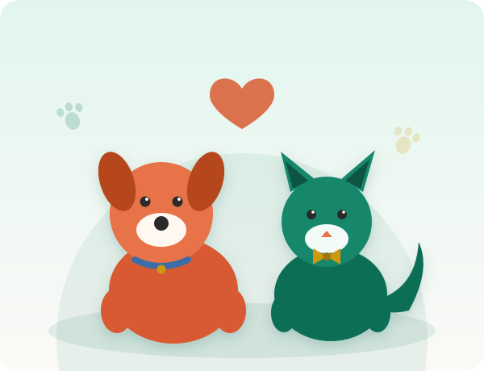

# Ubuntu Paws Animal Rescue — Website Project

## Student Information
- **Full Name:** [Your Full Name]
- **Student Number:** [Student Number]
- **Subject:** [Subject Name and Code]
- **Group:** [Group, if applicable]

## Project Overview
Ubuntu Paws Animal Rescue is a fictional, volunteer-run non-profit organisation based in
Johannesburg, Gauteng, dedicated to rescuing, rehabilitating and rehoming abandoned and
injured animals. This repository contains the HTML, CSS and (in later parts) JavaScript
for a functional, responsive, SEO-friendly website built for this organisation as part of
the Website Development Project of Learning (PoE).

The organisation currently has no website and relies solely on a Facebook page, which
limits discoverability and does not support structured adoption, volunteer or sponsorship
enquiries. This website addresses that gap.

## Website Goals and Objectives
- Increase adoption enquiries by giving the shelter's available animals an online presence.
- Grow the volunteer and foster-carer base through an accessible enquiry process.
- Raise donation and sponsorship income by clearly communicating how funds are used.
- **KPIs:** number of adoption enquiries per month, volunteer/sponsor sign-ups, and
  overall page visits, tracked from launch.

## Key Features and Functionality
- Responsive navigation menu linking every page on the site.
- Homepage with a hero section and calls to action to adopt, volunteer or donate.
- About Us page covering the organisation's history, mission, vision and team.
- Services page listing adoptable animals and the rescue/rehabilitation process.
- Enquiry page with a form covering adoption, volunteering and sponsorship enquiries.
- Contact page listing two physical locations (main shelter and foster care office)
  with a general contact form.

## Timeline and Milestones
| Milestone | Description | Status |
|---|---|---|
| Part 1 | Project planning, proposal, HTML structure | Complete |
| Part 2 | CSS styling and responsive design | Complete |
| Part 3 | JavaScript functionality, SEO, forms and deployment | Complete (deploy and fill in placeholders) |

## Part 1 Details

### Sitemap
```
Homepage (index.html)
 ├── About Us (about.html)
 ├── Services (services.html)
 ├── Enquiry (enquiry.html)
 └── Contact (contact.html)
```
All five pages share a common header, navigation menu and footer. The navigation
menu links to every page and highlights the current page with an `active` class.

### File and Folder Structure
```
ubuntu-paws/
├── index.html
├── about.html
├── services.html
├── enquiry.html
├── contact.html
├── css/
│   └── style.css
├── js/
│   └── main.js
├── data/
│   └── animals.json          (Part 3: animal listings loaded with fetch)
├── images/
│   ├── hero-desktop.svg, hero-mobile.svg, favicon.svg
│   ├── simba-cross-breed-dog.svg, miso-tabby-cat.svg, rocky-terrier-mix.svg
│   └── og-image.png          (Part 3: social sharing preview)
├── documents/
│   └── (supporting documents, e.g. researched content)
├── robots.txt                (Part 3)
├── sitemap.xml               (Part 3)
├── _headers                  (Part 3: security headers for Netlify)
└── README.md
```

## Part 2 Details
This section maps directly onto the Part 2 brief ("Designing the Visuals: CSS
Styling and Responsive Design") so each requirement is easy to check against
what was actually built.

### 2.1 External stylesheet
All styling lives in one external file, `css/style.css`, linked from every
HTML page's `<head>` with `<link rel="stylesheet" href="css/style.css">`.
Filenames follow a consistent lower-case, hyphenated naming convention
throughout the project (`style.css`, `hero-mobile.svg`, `favicon.svg`, etc.).

### 2.2 Base style
A reset at the top of the stylesheet (`*, *::before, *::after { box-sizing:
border-box; margin: 0; padding: 0; }`) removes inconsistent browser defaults.
Base font family, size, colour and line-height are set once on `body` and
inherited everywhere. A `:root` block defines the full colour scheme
(`--color-primary`, `--color-secondary`, etc.) and spacing scale
(`--space-xs` to `--space-xl`) as CSS custom properties, so every margin,
padding and colour in the file references one of a small set of values
instead of repeating magic numbers — this is also what keeps selector counts
low (see 2.4/2.5 below): most components reuse the same handful of variables
rather than each needing its own bespoke declarations.

### 2.3 Typography styles
`font-family`, `font-size`, `font-weight`, `line-height` and `letter-spacing`
are all set explicitly on `h1`/`h2`/`h3`/`p`. Two Google Fonts are used —
Poppins for headings, Nunito Sans for body text — loaded via `<link>` tags.
A typographic scale is defined once as custom properties (`--fs-sm` through
`--fs-2xl`) and reused by every heading and text element, with `clamp()` on
the two largest sizes so headings scale smoothly across breakpoints instead
of jumping abruptly.

### 2.4 Layout structure
- **CSS Grid:** the page shell (`header`/`main`/`footer`) is laid out with
  `display: grid` and `grid-template-areas` on `<body>`. The homepage hero
  becomes a two-column grid (`grid-template-columns: 1.1fr 1fr`) from 900px
  up. The contact page uses `grid-template-areas` to place the location
  cards beside the message form on wider screens. Card collections
  (highlights, animals, team members, locations) all use
  `display: grid` with `grid-template-columns` that change per breakpoint.
- **Flexbox:** the header uses `display: flex` with `justify-content:
  space-between` and `align-items: center` to position the logo and nav.
  Buttons and form rows use `flex-direction`, `align-items` and `gap` to
  align icons with text.

### 2.5 Visual styles
Cards and buttons use `background-color` (and gradient `background`),
`border`/`border-top`, `border-radius` and `box-shadow` for depth. Every
interactive element has all three required pseudo-class states:
- `:hover` — nav pills highlight, buttons lift, cards lift with a larger
  shadow, form field borders darken.
- `:focus-visible` — buttons and form fields get a visible outline/glow so
  the site is usable by keyboard, matching the same colour as `:hover`.
- `:active` — buttons compress slightly (`transform: scale(0.97)`) to give
  tactile click feedback.

### 3.1 Breakpoints
Three explicit breakpoints are used, mobile-first (base styles are mobile,
each `@media` rule adds/overrides for larger screens):
- **Mobile** — base styles, up to 599px: single-column layout throughout,
  stacked navigation, one-column card grids.
- **Tablet** — `@media (min-width: 600px)`: card grids move to 2–3 columns.
- **Small desktop** — `@media (min-width: 900px)`: the hero becomes
  two-column, the contact page splits into a two-column grid, animal/team
  card grids gain another column.
- **Large desktop** — `@media (min-width: 1200px)`: the max content width
  and hero padding increase slightly for very wide screens.

### 3.2 Relative units
Font sizes and spacing use `rem` (scales with the user's root font size) and
`em` (scales with the local font size, e.g. icon sizing relative to their
button's text). Grid columns use `fr` units, and the full-bleed stats band
uses `vw`/`%`-based widths so it always spans the true viewport width
regardless of the page's max-width container.

### 3.3 Responsive images
The homepage hero uses a `<picture>` element with a `<source media="(min-
width: 900px)" srcset="images/hero-desktop.svg">` and a fallback `` — an **art-directed** responsive image: a
simpler, tighter illustration is served on narrow screens and a fuller scene
on wide screens, rather than just scaling the same image. Both files are
original SVG illustrations built for this project (see References), so there
are no licensing concerns.

### 3.4 Test and iterate
Tested using browser developer tools' device toolbar at mobile (~375px),
tablet (~768px) and desktop (~1280px+) widths, confirming the nav, card
grids, hero layout and contact page all adapt correctly at each breakpoint.

**TODO before submission:** add screenshots of the site at mobile, tablet and
desktop widths to this README (or to `images/` and reference them here), as
required by the brief.

### Visual design (beyond the core rubric)
On top of the requirements above, the site also uses original SVG
illustrations (`images/hero-mobile.svg`, `images/hero-desktop.svg`,
`images/favicon.svg`) hand-built for this project, small inline SVG icons
throughout, gradient buttons/header, a full-bleed diagonal stats band
(`clip-path`), initials-based team avatars, an "Available!" ribbon on animal
cards, icon-prefixed form fields, a floating "Adopt & Donate" button, and a
`prefers-reduced-motion`-aware fade-in entrance animation. None of this was
explicitly required by the brief, but it builds on the same techniques
(Grid/Flexbox, custom properties, pseudo-classes) rather than replacing them.

## Part 3 Details
Part 3 adds JavaScript interactivity, search engine optimisation (SEO), validated
forms and deployment. Everything is built as progressive enhancement: with
JavaScript switched off, all content and both forms are still present.

### 2.1 Interactive elements
| Feature | Where | How it works |
|---|---|---|
| Accordion (FAQ) | `services.html` | Buttons with `aria-expanded`/`aria-controls`; one panel open at a time |
| Tabs (ways to help) | `about.html` | `role="tablist"` pattern with arrow-key, Home and End support |
| Modal | `services.html` | "Learn more" opens animal details in a native `<dialog>`; Esc, the close button or a backdrop click closes it and focus returns to the trigger |
| Lightbox gallery | `services.html` | Gallery links open a full-size viewer with previous/next buttons and arrow-key navigation |
| Interactive map | `contact.html` | Leaflet with OpenStreetMap tiles shows both locations with popups; a text fallback shows if the map cannot load |
| Animations | all pages | CSS transitions plus JavaScript (`IntersectionObserver`) for scroll-reveal and animated count-up statistics on the homepage; disabled for `prefers-reduced-motion` |
| DOM manipulation | all pages | Mobile menu toggle created by script; cards, modal, lightbox and form responses are built with `createElement`/`textContent` |

### 2.2 Dynamic content
- `services.html` loads its animal listings from `data/animals.json` using `fetch()`
  and renders the cards with JavaScript. If the file cannot be fetched (for example
  when the page is opened straight from disk), a built-in copy of the data is used.
- **Search, filter and sort:** visitors can search by name or keyword, filter by
  species and sort by name or age. The result count is announced with `aria-live`.
- Each card links to `enquiry.html?animal=<id>`; the enquiry form reads this and
  pre-selects Adoption and that animal.

### 3. Search Engine Optimisation
**3.1 On-page SEO**
- **Keyword research:** each page targets a primary phrase and related terms, using
  search wording South African adopters would use.

| Page | Primary keyword | Supporting keywords |
|---|---|---|
| index.html | animal rescue Johannesburg | adopt a dog Johannesburg, adopt a cat Gauteng, volunteer animal shelter |
| about.html | Johannesburg animal rescue NPO | foster care network Gauteng, animal rescue mission |
| services.html | adopt a dog, cat or rabbit in Johannesburg | animal adoption fees, pets for adoption Gauteng |
| enquiry.html | adopt, volunteer or sponsor | sponsor a rescue animal, adoption application |
| contact.html | animal shelter Bramley | animal rescue Randburg, Johannesburg animal shelter address |

- **Title tags and meta descriptions:** unique on every page (titles 50-57
  characters, descriptions 117-139 characters), plus `keywords`, `robots`,
  canonical URL, Open Graph and Twitter card tags so links preview well when shared.
- **Header tags:** exactly one `<h1>` per page, then `<h2>`/`<h3>` in order with no skipped levels.
- **Image optimisation:** descriptive file names (`simba-cross-breed-dog.svg`,
  `miso-tabby-cat.svg`), meaningful `alt` text, explicit `width`/`height` to prevent
  layout shift, and `loading="lazy"` on below-the-fold images.
- **URL structure:** short, lower-case, descriptive file names (`about.html`, `services.html`).
- **Internal linking:** the homepage, about, services and contact pages link to
  related pages in their content, and every page has a footer navigation.
- **Mobile-friendliness:** responsive layout (Part 2), viewport meta tag, a
  collapsible mobile menu and touch-sized buttons.
- **Structured data:** JSON-LD `AnimalShelter` markup on the homepage with both
  addresses, opening hours and coordinates (supports local search results).

**3.2 Off-page SEO (plan)**
These are activities that happen outside the code and are planned rather than built:
- **Backlinks:** request links from Johannesburg animal-welfare directories, local
  vet practices, pet shops, community Facebook groups and the school/university
  community; submit the site to free NPO directories.
- **Social media:** the existing Facebook page will link to the website, and each
  new animal will be shared with a link to its enquiry page. Open Graph and Twitter
  tags (above) control how those shared links appear.
- **Local SEO:** claim and verify a Google Business Profile for each of the two
  locations, keeping the name, address and phone number identical to the website,
  and encourage adopters to leave reviews.

**3.3 Additional requests**
- `robots.txt` allows all crawlers, blocks `/documents/` and points to the sitemap.
- `sitemap.xml` lists all five pages with last-modified dates and priorities.
- **Page speed:** scripts use `defer`, fonts use `preconnect` and `display=swap`,
  images have fixed dimensions, below-the-fold images are lazy-loaded, the animal
  data is a small JSON file, and illustrations are lightweight SVG.
- **Security:** all dynamic text is inserted with `textContent` (never `innerHTML`
  with user input) to prevent cross-site scripting; inputs have length limits and
  validation; forms include a hidden honeypot field against spam bots; external links
  use `rel="noopener noreferrer"`; a `referrer` policy is set; `_headers` adds
  `X-Content-Type-Options`, `X-Frame-Options`, `Referrer-Policy` and `Permissions-Policy`
  on Netlify; and the hosting platform provides HTTPS.

### 4. Form functionality and validation
**HTML forms:** both forms use `<form>` with `action` and `method`, labelled
`<input>`, `<select>` and `<textarea>` elements, and every field has a matching
`<label for>`.

**HTML5 validation attributes:** `required`, `type="email"`, `type="tel"`,
`minlength`, `maxlength`, `pattern` (South African phone numbers) and `autocomplete`.

**JavaScript validation:** client-side checks run on blur, while typing (after the
first visit to a field) and on submit. Messages appear beside each field, fields
get `aria-invalid`, focus moves to the first error, and a live character counter
shows the message length.

| Rule | Example of a rejected value | Message shown |
|---|---|---|
| Name: letters, spaces, `'`, `.`, `-`, 2-80 characters | `J0hn 99` | "Please use letters, spaces, apostrophes..." |
| Email format | `not-an-email` | "Please enter a valid email address..." |
| SA phone (optional): `0` or `+27` then 9 digits | `12345` | "Please enter a valid South African number..." |
| Message: 10-1000 characters | `short` | "Your message must be at least 10 characters" |
| Select required | (nothing chosen) | "Please choose an option." |

**enquiry.html:** a conditional "Which animal?" field appears for adoption
enquiries. On a valid submit the form is sent with AJAX (`fetch`, no page reload),
the button shows "Sending..." and the page then displays a tailored response:
adoption (the chosen animal's fee and availability, or a waiting-list message if
the adoption is pending), volunteering (cost, openings and next orientation),
sponsorship (the three monthly tiers) or a general reply time.

**contact.html:** on a valid submit, the details (name, email, phone, message
type, subject and message) are compiled into an email and previewed. The visitor
then selects **Open in my email app** (a `mailto:` link addressed in the code to
`shelter@ubuntupaws.org.za`, or `fostercare@ubuntupaws.org.za` for fostering
messages) or **Copy email text**.

**Form submission endpoint:** the enquiry form's `action` is
`https://formspree.io/f/YOUR_FORM_ID`. While that placeholder is present the form
runs in *demo mode*: validation and the tailored response work, but no email is
actually sent. To receive real submissions, create a free Formspree form and
replace `YOUR_FORM_ID` with your form's id.

### 5. Testing
- **Automated checks:** all five pages were loaded in a simulated browser (jsdom)
  against a local web server and 76 checks passed, covering: no script errors,
  navigation toggle, tabs (mouse and keyboard), accordion, animal search/filter/sort,
  modal, lightbox, the JSON fallback, every validation rule, the tailored enquiry
  responses, the honeypot, and the composed email (recipient, subject, body).
- **Static checks:** all internal links and asset paths resolve; no duplicate ids;
  every `aria-*`/`for` reference has a target; one `<h1>` per page; all images have
  `alt`, width and height; JSON-LD, `animals.json` and `sitemap.xml` are valid.
- **Manual checks to repeat in a real browser** (Chrome DevTools device toolbar):
  the layout at mobile, tablet and desktop widths, the map tiles loading, and the
  `mailto:` link opening an email app.

### 6. Deployment (GitHub Pages)
1. Push the project to the GitHub repository (the `index.html` file must be in the repository root).
2. In the repository choose **Settings > Pages**, set **Source** to *Deploy from a branch*, pick `main` and `/ (root)`, then save.
3. After a minute the site is live at `https://<username>.github.io/<repository>/`.
4. Replace `https://YOUR-USERNAME.github.io/ubuntu-paws/` with your real address in
   every `canonical`, `og:url`, `og:image` and `twitter:image` tag, in the JSON-LD on
   `index.html`, in `sitemap.xml` and in `robots.txt` (use find-and-replace across the project).
5. Add the live link under **Live site** below and submit the repository link on the LMS.

**Live site:** [add your deployed URL here]
**Repository:** [add your GitHub repository URL here]

## Changelog
Track changes and improvements to the website here as the project progresses.

| Date | Change | Author |
|---|---|---|
| [Date] | Initial project structure, HTML pages for all 5 sitemap pages, base stylesheet, and README created for Part 1. | [Your Full Name] |
| [Date] | Part 2: Rebuilt `css/style.css` with CSS custom properties, a typography scale (Google Fonts: Poppins/Nunito Sans), CSS Grid page layout (`grid-template-areas`) and Flexbox navigation, `:hover`/`:focus-visible`/`:active` states on links, buttons and form fields, and mobile-first responsive breakpoints at 600px/900px/1200px. Added a responsive `<picture>`/`srcset` hero image to `index.html` and a two-column grid layout to `contact.html` on wider screens. | [Your Full Name] |
| [Date] | Part 2 visual design pass: added original SVG artwork (`hero-mobile.svg`, `hero-desktop.svg`, `favicon.svg`) and inline SVG icons across all pages; restructured the homepage hero into a two-column CSS Grid (art-directed responsive image); added a full-bleed stats band, icon badges, gradient buttons/header, card hover/lift effects, and a `prefers-reduced-motion`-aware fade-in entrance animation. | [Your Full Name] |
| [Date] | Part 2 visual polish pass 2: diagonal `clip-path` on the stats band; initials-based avatars on the team list; an "Available!" ribbon badge on animal cards; icon-prefixed form fields (email/phone/name, via inline SVG `background-image`); a fixed floating "Adopt & Donate" call-to-action button; a "Back to top" footer link; trust-badge pills in the hero; a decorative blob behind inner-page headings; and a button hover "shine" sweep. | [Your Full Name] |
| [Date] | Part 2 colour expansion: extended the palette from 2 to 4 brand colours (teal, orange, gold, blue) via new custom properties/gradients; applied them to cycle across icon badges, team avatars, animal-card and location-card accents, and the header background; added a blue collar and gold bow tie to the hero illustration's dog and cat, and gave each scattered paw print a different palette colour. | [Your Full Name] |
| [Date] | Part 3 JavaScript: rewrote `js/main.js` with a mobile menu, accordion, tabs, modal, lightbox gallery, scroll-reveal and animated counters, a Leaflet/OpenStreetMap map, and animal listings loaded from `data/animals.json` with search, species filter and sort (and a built-in fallback copy of the data). | [Your Full Name] |
| [Date] | Part 3 forms: rebuilt both forms with HTML5 validation attributes, custom JavaScript validation with inline error messages, a honeypot field and character counter; the enquiry form submits with AJAX and shows a tailored response (fees and availability for adoption, volunteering details, sponsorship tiers); the contact form compiles the details into a `mailto:` email addressed by message type. | [Your Full Name] |
| [Date] | Part 3 SEO and performance: unique titles, meta descriptions and keywords, canonical, Open Graph and Twitter tags on every page; JSON-LD `AnimalShelter` data; descriptive image names and alt text; internal links and footer navigation; skip link; `robots.txt`, `sitemap.xml` and `_headers`; deferred scripts, lazy-loaded images with fixed dimensions; added `height: auto` to images and a `[hidden]` rule in the CSS. | [Your Full Name] |
| [Date] | Part 3 content: added original animal portrait SVGs, `data/animals.json` (7 animals), an FAQ accordion, a "Ways you can help" tabs section on About, a photo gallery on Services, directions links and map on Contact, and `og-image.png`. | [Your Full Name] |
| [Date] | Part 2 feedback corrections: *(add entries here once the Part 2 feedback is received and addressed, with as much detail as needed)*. | [Your Full Name] |
| [Date] | Part 1 feedback corrections: *(no specific Part 1 feedback was available at the time of this edit — add entries here once feedback is received and addressed)*. | [Your Full Name] |

## References
References are cited using the Harvard Style Referencing Guide, adapted for the IIE.
References specific to each Website Project Proposal are included in the
*Website Project Proposal* document. General references used to complete Part 1 are
listed below and will be updated with new references as required in Part 2 and Part 3.

- [Author/Organisation. (Year). *Title of source*. Retrieved from URL — add each
  source you actually use for code snippets, text content, or images.]
- Google. (2026). *Google Fonts: Poppins & Nunito Sans*. Retrieved from https://fonts.google.com/
- Agafonkin, V. (2023). *Leaflet: an open-source JavaScript library for mobile-friendly interactive maps* (version 1.9.4). Retrieved from https://leafletjs.com/
- OpenStreetMap contributors. (2026). *OpenStreetMap*. Retrieved from https://www.openstreetmap.org/copyright
- Formspree. (2026). *Formspree: form backend documentation*. Retrieved from https://formspree.io/
- Mozilla Developer Network. (2026). *HTML dialog element* and *Fetch API*. Retrieved from https://developer.mozilla.org/
- W3C. (2023). *ARIA Authoring Practices Guide: Tabs and Accordion patterns*. Retrieved from https://www.w3.org/WAI/ARIA/apg/
- Schema.org. (2026). *AnimalShelter*. Retrieved from https://schema.org/AnimalShelter
- All illustrations and icons (all `.svg` files and `og-image.png` in `images/`, and inline page icons) are original vector artwork created for this project — no external image sources used.

